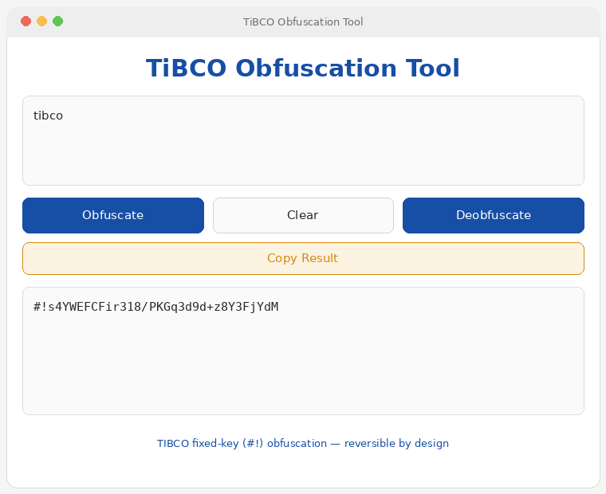

# TiBCO Obfuscation Tool

A small cross-platform desktop app ([Fyne](https://fyne.io)) to **obfuscate and
deobfuscate TIBCO fixed-key (`#!`) secrets** — the values that appear in TIBCO
config and `.gv` files prefixed with `#!`.



## Download

Prebuilt binaries are produced by CI on every push and attached to tagged
releases:

- **macOS** (universal — Apple Silicon + Intel): `TiBCO-Obfuscation-Tool-macOS.zip`
- **Windows** (x64): `TiBCO Obfuscation Tool.exe`

Grab them from the [Releases](../../releases) page, or from the **Actions** run
artifacts for an untagged build.

## Usage

1. Paste a plaintext password **or** a `#!` obfuscated secret into the input box.
2. Click **Obfuscate** to produce a `#!…` value, or **Deobfuscate** to recover
   the plaintext. The `#!` prefix is optional on input.
3. **Copy Result** puts the output on the clipboard; **Clear** empties both boxes.

`Obfuscate` uses a fresh random IV each run, so the `#!` output differs every
time but always deobfuscates back to the same value.

## Build from source

Requires [Go](https://go.dev/dl) and a C toolchain (Fyne uses CGO).

### macOS
```bash
git clone https://github.com/ddpa/tibco-obfuscation-tool.git
cd tibco-obfuscation-tool
./build-macos.sh          # produces "TiBCO Obfuscation Tool.app"
# or:
make universal            # single Intel + Apple-Silicon universal .app
```
One-time prerequisites if missing: `brew install go` and `xcode-select --install`.

### Windows
Install Go and a gcc (e.g. [TDM-GCC](https://jmeubank.github.io/tdm-gcc/)), then:
```bash
go install fyne.io/tools/cmd/fyne@latest
fyne package -os windows -name "TiBCO Obfuscation Tool" -app-id com.diogo.tibcoobfuscationtool -icon Icon.png
```

### Run without packaging
```bash
make run      # or: go run .
```

## Unsigned builds

These binaries are **unsigned**.

- **macOS:** on first launch, right-click the app → **Open** → **Open**, or run
  `xattr -dr com.apple.quarantine "TiBCO Obfuscation Tool.app"`.
- **Windows:** SmartScreen may warn — **More info** → **Run anyway**.

## How it works

The `#!` form is TIBCO's **fixed-key** obfuscation (one of three modes — fixed,
custom, and machine key). It is **3DES** (`DESede/CBC/PKCS5Padding`) with a
24-byte key that ships inside TIBCO's own `ObfuscationEngine` library, so it is
the same on every install. The encoded value is `base64( IV[8] ‖ ciphertext )`,
and the plaintext is stored as UTF-16 little-endian.

Because the key is public, `#!` values are **reversible by anyone** and should
be treated as plaintext-equivalent — useful for migrating configs, automation
and auditing systems you administer. Secrets created with a *custom key* or
*machine key* are **not** recoverable with this tool.

> ⚠️ This repository is public. Do not commit real TIBCO `#!` secrets or config
> files to it.

## License

[MIT](LICENSE)
